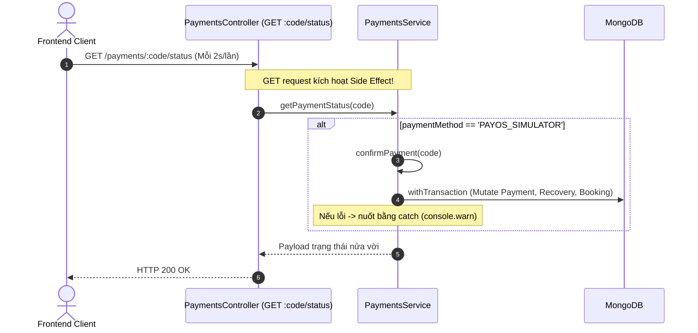
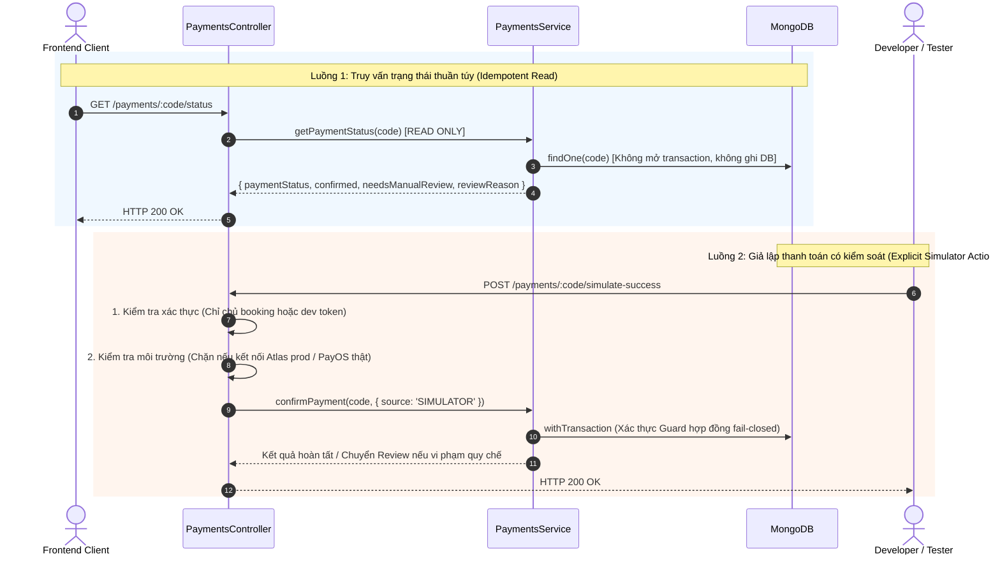

# VIBEHUE — PAYMENT STATE RECONCILIATION & READ-ONLY MIGRATION PLAN (P0)

**Date**: 2026-11-03  
**Status**: PROPOSED FOR BUSINESS/TECH LEAD APPROVAL (NO BACKEND MUTATION APPLIED YET)  
**Scope**: `PaymentsService`, `PaymentsController`, `V2PaymentFinalizationService`, `PaymentRecoveryService`  

---

## 1. Sequence Diagrams: Trước và Sau khi Tách bạch Read-Only

### Hiện trạng rủi ro (Trước khi thay đổi):


### Kiến trúc an toàn đề xuất (Sau khi thay đổi):


---

## 2. Kế hoạch di trú Backend GET Status sang Read-Only (Migration Plan)

### A. Tách riêng Endpoint Simulator
* Thêm endpoint rõ ràng: `POST /api/payments/:code/simulate-success`.
* **Rào chắn bảo mật 4 lớp**:
  1. **Không phụ thuộc duy nhất vào `NODE_ENV`**: Kiểm tra trực tiếp connection string của DB; nếu là cluster production Atlas (`vibehue_db`) hoặc PayOS live credentials (`api.payos.vn`), endpoint **lập tức từ chối với HTTP 403 Forbidden**.
  2. **Ủy quyền người dùng (Authorization)**: Chỉ chính chủ booking (`customerId === user.sub`) hoặc tài khoản có role `ADMIN` / `DEVELOPER` mới được gọi endpoint này. Ngăn chặn tuyệt đối việc người dùng kích hoạt thanh toán thay người khác.
  3. **Chống trùng lặp & xung đột đồng thời (Concurrency & Idempotency Lock)**: Dùng lease claim hoặc unique status transition `{ status: 'PENDING' } -> { status: 'SUCCESS' }`. Nếu request thứ hai gọi tới, trả về HTTP 409 hoặc `already_processing`.
  4. **Giữ nguyên điều kiện Hợp đồng**: Simulator **bắt buộc** đi qua `ContractCheckoutGuard`. Nếu quy chế là `DRAFT` hoặc Shop chưa chấp thuận, hệ thống chuyển sang `REVIEW_REQUIRED`, **không bao giờ cấp trạng thái SUCCESS giả tạo**.

### B. Giữ nguyên Real Webhook & Recovery
* Luồng Webhook thực của PayOS (`POST /api/payments/webhook`) giữ nguyên 100% logic xác thực chữ ký HMAC SHA256 và idempotency qua `PaymentWebhookEvent`.
* Worker `PaymentRecoveryService.processDue()` giữ nguyên cơ chế quét định kỳ và tái thẩm định binding bất biến.

---

## 3. Quy trình Người vận hành (Operator/Admin Desk) xử lý `REVIEW_REQUIRED`

Khi một giao dịch rơi vào `needsManualReview: true` (ví dụ: Shop đổi điều khoản trong lúc khách chuyển khoản, hoặc quy chế đang DRAFT), người vận hành xử lý theo 2 luồng chuẩn:

```
                                [Giao dịch REVIEW_REQUIRED]
                                             │
                       ┌─────────────────────┴─────────────────────┐
                       ▼                                           ▼
          [Lựa chọn A: DUYỆT KÍCH HOẠT]               [Lựa chọn B: HOÀN TIỀN KHÁCH]
          (Khi điều kiện đã được bổ sung)             (Khi không thể tiếp tục đơn)
                       │                                           │
                       ▼                                           ▼
          • Admin bấm "Duyệt đơn"                     • Admin bấm "Hoàn tiền"
          • Ghi nhận approvedByAdminId                • Tạo RefundIntent từ orderCode gốc
          • Cập nhật booking.status = CONFIRMED       • PayOS API hoàn 100% tiền cọc
          • Gán finalizedPaymentId                    • Chuyển booking.status = CANCELLED
          • Giữ nguyên timestamp tiền khách           • Lưu lịch sử đối soát minh bạch
```

* **Tuyệt đối không**:
  - Không tự đổi payment thành FAILED (vì tiền khách đã nạp thành công).
  - Không xóa payment hoặc booking.
  - Không tự gán acceptance giả lập cho Provider.
  - Không sửa nội dung `ContractVersion` đã tạo.

---

## 4. Danh sách các thành phần cần điều chỉnh (Chờ phê duyệt)

1. `backend/src/modules/payments/controllers/payments.controller.ts`: Thêm `POST :code/simulate-success`, loại bỏ logic gọi confirm trong GET.
2. `backend/src/modules/payments/services/payments.service.ts`: Xóa bỏ đoạn `auto-confirm` trong `getPaymentStatus()`.
3. Frontend: Nút "Giả lập thanh toán" trong môi trường Test Dashboard (nếu cần cho tester).
