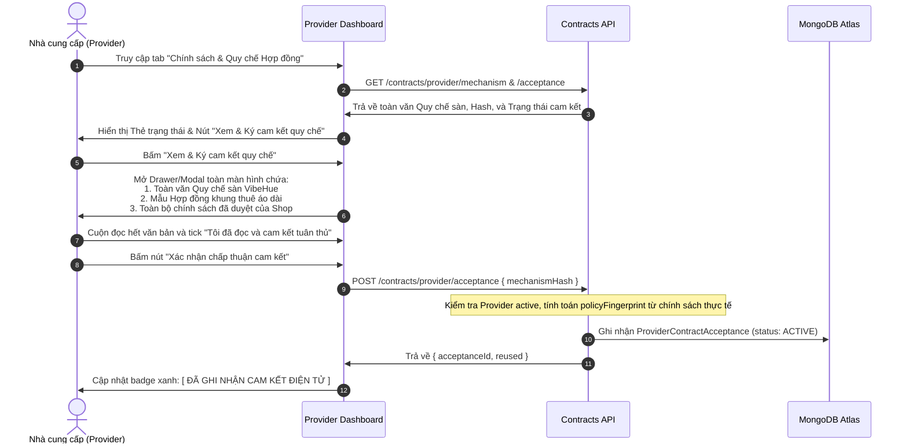

# VIBEHUE — VÒNG ĐỜI CHẤP THUẬN QUY CHẾ CỦA NHÀ CUNG CẤP (PROVIDER ACCEPTANCE LIFECYCLE)

Tài liệu quy định chi tiết quy trình, bằng chứng pháp lý điện tử, cơ chế ghi nhận và quản lý vòng đời cam kết của Nhà cung cấp (Provider) đối với Quy chế hoạt động sàn giao dịch VibeHue.

---

## 1. Bản chất Pháp lý và Tuyên bố Minh bạch (Legal Characterization & Transparency)

### 1.1. Phân định với Chữ ký số Chứng thực (CA Digital Signature)
- **Căn cứ pháp lý:** Theo Luật Giao dịch điện tử Việt Nam số 20/2023/QH15 và Bộ luật Dân sự 2015 (Điều 119, Điều 472):
  - *Chữ ký số (Digital Signature)* đòi hỏi chứng thư chữ ký số do tổ chức cung cấp dịch vụ chứng thực chữ ký số công cộng (CA) cấp, sử dụng cặp khóa bất đối xứng và thiết bị lưu khóa an toàn (USB Token, HSM, Cloud Remote Signing).
  - Thao tác đăng nhập tài khoản và bấm chấp thuận trên giao diện web VibeHue là **Hình thức chấp thuận điện tử thông qua phương thức xác thực định danh tài khoản nền tảng (Electronic Consent via Authenticated Platform Account)** theo Điều kiện giao dịch chung và Quy chế hoạt động sàn đã đăng ký với Bộ Công Thương. Theo Bộ luật Dân sự 2015, hợp đồng điện tử xác lập qua thông điệp dữ liệu có giá trị pháp lý ràng buộc các bên; việc thiếu file PDF hoặc mã băm không làm vô hiệu giao kết dân sự nếu ý chí các bên là tự nguyện và rõ ràng, nhưng việc lưu trữ đầy đủ PDF và SHA-256 evidence package là điều kiện tiên quyết để đảm bảo giá trị chứng cứ pháp lý (Evidentiary Weight) đầy đủ nhất khi xảy ra tranh chấp hoặc khiếu nại bồi thường.
- **Quy tắc hiển thị (UI Transparency Rules):**
  - **TỐI KỴ:** Tuyệt đối không sử dụng các từ ngữ gây hiểu lầm như *"Đã ký số"*, *"Chữ ký số chuẩn CA"*, *"Đã ký điện tử bằng khóa bí mật"*.
  - **CHUẨN XÁC:** Hiển thị đúng bản chất:
    - `[ ĐÃ CHẤP THUẬN ĐIỆN TỬ THEO QUY CHẾ SÀN ]`
    - `Hình thức xác thực: Tài khoản quản trị Provider (APP_SESSION)`
    - `Mã băm chứng thực cam kết: SHA-256 (...)`

---

## 2. Quy trình Trải nghiệm Chấp thuận của Provider (Step-by-step UX Flow)



---

## 3. Dữ liệu Kiểm chứng Toàn vẹn (Audit Trail Metadata Schema)

Mỗi lần Provider bấm chấp thuận cam kết, hệ thống ghi nhận vào bảng `provider_contract_acceptances` bản ghi bất biến với đầy đủ các thuộc tính kiểm chứng:

```typescript
export interface ProviderContractAcceptanceRecord {
  _id: Types.ObjectId;
  providerId: Types.ObjectId;          // Mã định danh Nhà cung cấp
  acceptedByUserId: Types.ObjectId;    // Tài khoản User trực tiếp thực hiện thao tác
  scope: 'AO_DAI_RENTAL';              // Phạm vi nghiệp vụ áp dụng
  
  // Dữ liệu văn bản quy chế nền tảng
  mechanismVersion: string;            // Ví dụ: 'qc-vibehue-2026-v1'
  mechanismHash: string;               // SHA-256 canonical của toàn văn quy chế sàn
  templateVersion: string;             // Ví dụ: 'ao-dai-rental-v2'
  
  // Dữ liệu chính sách riêng của Provider
  policyVersionId: Types.ObjectId;     // Tham chiếu đến ProviderContractPolicyVersion (APPROVED)
  policyFingerprint: string;           // SHA-256 canonical của chính sách shop tại thời điểm cam kết
  
  // Dấu vết giao dịch và xác thực
  status: 'ACTIVE' | 'REVOKED' | 'SUPERSEDED';
  acceptedAt: Date;                    // Thời điểm chính xác bấm chấp thuận
  revokedAt?: Date | null;             // Thời điểm thu hồi (nếu có)
  
  // Metadata phiên làm việc
  auditMetadata: {
    authMethod: 'PASSWORD_SESSION' | 'APP_SESSION';
    ipAddress?: string | null;         // IP mạng của Provider
    userAgent?: string | null;         // Trình duyệt / thiết bị
  };
}
```

---

## 4. Quản lý Sự kiện Thay đổi & Tái Chấp thuận (Re-acceptance & Version Triggers)

### 4.1. Trường hợp 1: Sàn cập nhật Quy chế nền tảng (Platform Mechanism Update)
- Khi VibeHue phát hành phiên bản quy chế mới (ví dụ từ `v1.0` lên `v2.0`):
  - Băm `mechanismHash` thay đổi.
  - Trạng thái cam kết của toàn bộ Provider chuyển sang `NEEDS_REACCEPTANCE`.
  - Trên Provider Dashboard xuất hiện cảnh báo nổi bật màu cam:
    > *"Quy chế hoạt động sàn đã có bản cập nhật mới (v2.0). Vui lòng đọc lại và ký cam kết để tiếp tục nhận đơn thuê áo dài."*
  - **Quy tắc fail-closed:** Khi quy chế chưa được Provider tái chấp thuận, khách hàng thanh toán đơn thuê mới của Provider này sẽ bị chặn tại `ContractCheckoutGuard` với lý do `PROVIDER_AUTO_ACCEPTANCE_STALE`.

### 4.2. Trường hợp 2: Provider cập nhật Chính sách riêng (Shop Policy Update)
- Khi Provider thay đổi chính sách riêng của shop trong cơ sở dữ liệu:
  - Fingerprint tính toán tại thời điểm chuẩn bị hợp đồng sẽ không khớp với `policyFingerprint` mà Provider đã ký cam kết.
  - **Quy tắc P0 Fail-Closed:** Hệ thống phát hiện sự sai lệch và ném lỗi `PROVIDER_POLICY_ACCEPTANCE_STALE`. Tuyệt đối không tự động ghi đè hoặc âm thầm cập nhật `policyFingerprint` trên bản ghi cam kết của Provider.
  - Provider phải chủ động vào giao diện để kiểm tra và xác nhận lại cam kết với phiên bản chính sách mới.
  - Sau khi ký mới thành công, `policyFingerprint` mới sẽ có hiệu lực cho các booking tạo từ thời điểm đó trở đi.

---

## 5. Quy tắc Đóng băng Dữ liệu & Xử lý Xung đột Thời gian thực (Race Conditions & Parity)

1. **Bảo toàn tuyệt đối các Hợp đồng đã tạo:**
   - Dù Provider có sửa policy hay revoke cam kết, toàn bộ các `ContractVersion` đã tồn tại (ở các trạng thái `OFFERED`, `ACCEPTED`, `EFFECTIVE`) **vẫn giữ nguyên 100% snapshot, contentHash và bookingFingerprint ban đầu**.
   - Mọi truy vấn xem chi tiết hợp đồng, hiển thị A4 hoặc in file PDF của đơn hàng cũ phải đọc trực tiếp từ `contract_versions.snapshot`, không đọc lại bảng `providers` hay `provider_contract_acceptances` hiện hành.

2. **Xử lý xung đột khi Khách đang xem hợp đồng thì Shop đổi Policy:**
   - Khách hàng đang ở màn hình xem hợp đồng (Snapshot chứa `policyFingerprint_A`).
   - Shop cập nhật policy mới hoặc revoke cam kết.
   - Khi Khách hàng bấm **"Chấp thuận hợp đồng này"**:
     - `ContractConsentService` gọi `ContractPreparationService.assertSourcesUnchanged()` và `assertLiveHold()`.
     - Hệ thống phát hiện fingerprint nguồn đã thay đổi -> **Fail-closed**: Ném lỗi HTTP 409 `CONTRACT_VERSION_STALE`.
     - Frontend thông báo cho Khách: *"Nhà cung cấp vừa cập nhật điều khoản mới. Vui lòng tải lại trang để xem xét hợp đồng mới nhất."*
     - Hệ thống tự sinh phiên bản Version mới (V2) với điều khoản mới để khách xem xét lại một cách minh bạch.
