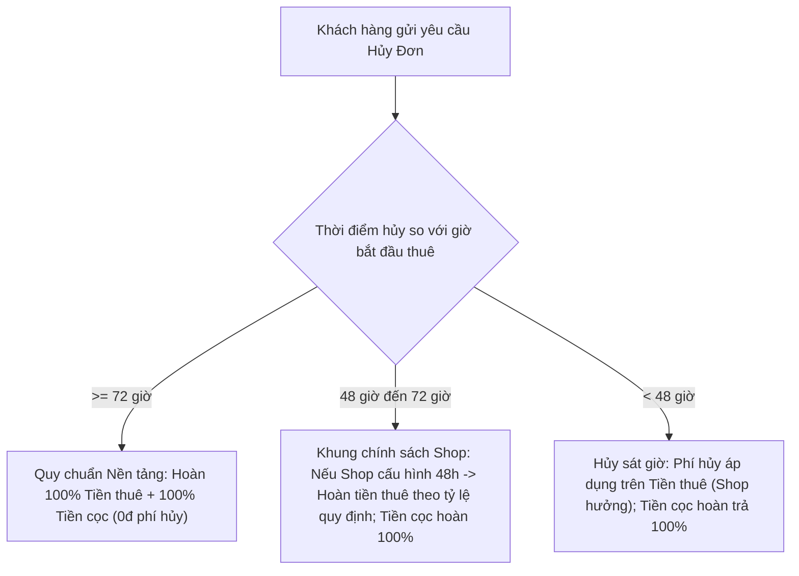
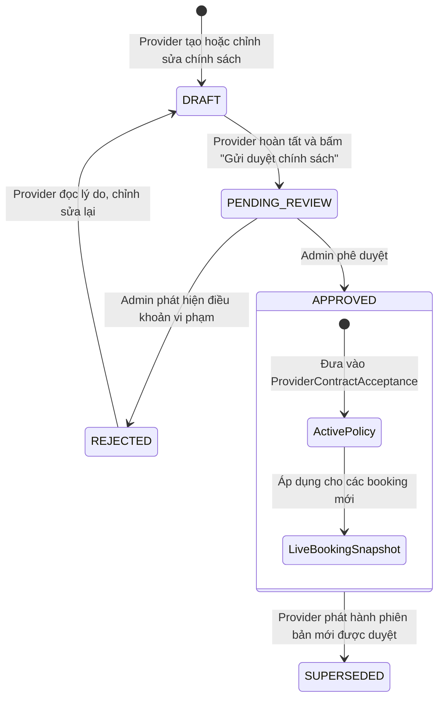

# VIBEHUE — THIẾT KẾ QUẢN LÝ CHÍNH SÁCH HỢP ĐỒNG NHÀ CUNG CẤP (PROVIDER CONTRACT POLICY MANAGEMENT)

Tài liệu thiết kế chi tiết cấu trúc dữ liệu, quy tắc ràng buộc (Validation), quy trình kiểm duyệt (Moderation), và vòng đời phiên bản (Lifecycle) cho chính sách thuê của Nhà cung cấp (Provider) trên nền tảng VibeHue.

---

## 1. Mục tiêu và Nguyên tắc Thiết kế

1. **Cấu trúc hóa dữ liệu (Structured Data):** Không để Provider viết văn bản tự do không kiểm soát. Mọi chính sách được bẻ nhỏ thành các trường có kiểu dữ liệu, đơn vị, giới hạn số và lựa chọn rõ ràng.
2. **Tuân thủ quy chế sàn (Platform Bound):** Các điều khoản riêng của Provider không được xung đột hoặc trái với Quy chế hoạt động sàn giao dịch VibeHue và pháp luật Việt Nam. Sàn đặt ra các "ngưỡng chặn an toàn" (Guardrails).
3. **Phân định trạng thái kiểm duyệt (Moderation Lifecycle):**
   - Chỉ chính sách ở trạng thái `APPROVED` mới được đưa vào snapshot hợp đồng thật.
   - Chính sách đang `DRAFT` hoặc `PENDING_REVIEW` chỉ hiển thị ở màn hình quản trị của shop, tuyệt đối không áp dụng cho booking của khách.
4. **Bảo toàn dữ liệu bất biến (Immutability):** Cập nhật policy mới chỉ sinh ra phiên bản mới cho các giao dịch tương lai; toàn bộ các hợp đồng cũ đã ký giữ nguyên snapshot tại thời điểm ký kết.

---

## 2. Cấu trúc Dữ liệu Chính sách Thuê Nhà cung cấp (Provider Rental Policy Schema)

### 2.1. Cấu trúc chi tiết (Schema Interface)

```typescript
export enum ProviderPolicyReviewStatus {
  Draft = 'DRAFT',                     // Đang soạn thảo
  PendingReview = 'PENDING_REVIEW',   // Đã gửi admin duyệt
  Approved = 'APPROVED',               // Đã duyệt, có hiệu lực
  Rejected = 'REJECTED',               // Bị từ chối (kèm lý do)
  Superseded = 'SUPERSEDED',           // Đã bị thay thế bởi phiên bản mới hơn
}

export interface GarmentCareRules {
  allowIroning: boolean;               // Cho phép ủi/là nhiệt độ thấp
  allowWashing: boolean;               // Khách có tự giặt trước khi trả hay không (mặc định: Không, shop tự giặt)
  prohibitedActions: string[];         // Hành vi cấm: xịt nước hoa trực tiếp, cắt chỉ, ghim kim băng kim loại làm tưa lụa...
  specialNotes?: string | null;        // Ghi chú chất liệu đặc thù (Gấm, Tơ tằm, Thêu tay...)
}

export interface AccessoryRules {
  includedAccessories: string[];       // Phụ kiện mượn kèm: Mấn, Trâm, Quạt, Guốc mộc...
  accessoryDepositMode: 'INCLUDED_IN_MAIN_DEPOSIT' | 'SEPARATE_DEPOSIT';
  separateAccessoryDeposit?: number;   // Tiền cọc phụ kiện riêng (nếu có, tối đa 200.000đ)
  lossPenaltyNotes?: string | null;    // Quy định bồi thường khi mất phụ kiện
}

export interface LateReturnPolicy {
  gracePeriodHours: number;            // Thời gian ân hạn trễ không tính phí (cấu hình nền tảng đề xuất: 1h - 4h, tối đa 6h theo business config)
  hourlyLateFee: number;               // Phí trễ mỗi giờ (nếu trễ dưới 6 tiếng, guardrail nền tảng: tối đa 50.000đ/h)
  dailyLateFee: number;                // Phí trễ mỗi ngày (guardrail nền tảng: tối đa 50% giá thuê/ngày hoặc 200.000đ/ngày)
  maxLateDaysAllowed: number;          // Quá số ngày này coi như mất đồ (mặc định: 3 ngày)
}

export interface DamageCompensationPolicy {
  minorDamageFee: number;              // Lỗi nhỏ giặt tẩy/khắc phục được (vết bẩn nhẹ, đứt chỉ viền, guardrail: tối đa 100.000đ)
  moderateDamagePercent: number;       // Hư hỏng vừa phải (rách đường may, lem màu, 10% - 30% giá trị niêm yết)
  severeDamageOrLossPercent: number;   // Hư hỏng nặng không thể phục hồi hoặc mất đồ (guardrail nền tảng: tối đa 100% giá trị niêm yết)
  disputeResolutionChannel: string;   // Kênh giải quyết tranh chấp (Sàn VibeHue làm trọng tài hòa giải)
}

export interface HandoverPolicy {
  maxRentalDays: number;               // Thời gian thuê tối đa cho 1 lượt đặt (cấu hình nền tảng đề xuất: 1 - 7 ngày, tối đa 14 ngày theo business config)
  checkInInspectionRequired: boolean;  // Bắt buộc chụp ảnh/video đồng kiểm khi nhận đồ (true)
  checkOutInspectionRequired: boolean; // Bắt buộc đồng kiểm khi trả đồ (true)
  returnLocationType: 'STORE_ONLY' | 'SUPPORT_SHIPPER'; // Hình thức trả đồ
}

export interface ProviderSupportContact {
  hotline: string;                     // Số hotline trực tiếp hỗ trợ giao dịch
  zaloOrSocial?: string | null;        // Kênh nhắn tin nhanh
  supportWorkingHours: string;         // Giờ làm việc hỗ trợ (ví dụ: 08:00 - 21:00)
}

/** Thực thể phiên bản chính sách của Provider */
export interface ProviderContractPolicyVersion {
  _id: Types.ObjectId;
  providerId: Types.ObjectId;
  versionNumber: number;               // 1, 2, 3...
  status: ProviderPolicyReviewStatus;
  
  handoverPolicy: HandoverPolicy;
  garmentCare: GarmentCareRules;
  accessories: AccessoryRules;
  lateReturn: LateReturnPolicy;
  damageCompensation: DamageCompensationPolicy;
  supportContact: ProviderSupportContact;
  customTermsText?: string | null;     // Điều khoản bổ sung tùy chỉnh (được kiểm duyệt)

  submittedAt?: Date | null;
  reviewedAt?: Date | null;
  reviewedByUserId?: Types.ObjectId | null;
  reviewNote?: string | null;          // Lý do từ chối nếu REJECTED
  approvedAt?: Date | null;
  policyFingerprint?: string | null;   // SHA-256 canonical của phiên bản policy này
  createdAt: Date;
  updatedAt: Date;
}
```

---

## 3. Quy tắc Ràng buộc & Ngưỡng Chặn Nền tảng (Platform Guardrails & Validation)

Để ngăn chặn việc Nhà cung cấp đưa ra các điều khoản bất lợi, chèn ép khách hàng hoặc gây mất cân bằng giao dịch, hệ thống áp dụng các kiểm tra tự động (fail-closed) trước khi cho phép gửi duyệt.

> [!NOTE]
> Các mức ngưỡng như `200.000đ/ngày`, `100% giá niêm yết`, `1-14 ngày`, `1-6 giờ` là **ngưỡng bảo vệ nội bộ (Internal Platform Guardrails)** do Ban Quản trị VibeHue thiết lập cho sàn thương mại điện tử, **không phải là các định mức bắt buộc do luật định**. Các khoảng giá trị cụ thể (`1–7` vs `1–14` ngày; `1–4` vs `1–6` giờ) là cấu hình kinh doanh (Platform Business Configs) đang chờ Business Sign-off chính thức từ đội ngũ Vận hành.

| Trường thông tin | Giới hạn tối thiểu | Giới hạn tối đa | Quy tắc bảo vệ người dùng (Platform Guardrails) |
| :--- | :--- | :--- | :--- |
| `maxRentalDays` | 1 ngày | 14 ngày (baseline đề xuất: 7 ngày) | Cấu hình nghiệp vụ nền tảng (chờ sign-off). Chặn hợp đồng thuê ngắn hạn vượt quá cấu hình tối đa của sàn. |
| `gracePeriodHours` | 1 giờ | 6 giờ (baseline đề xuất: 2-4 giờ) | Cấu hình nghiệp vụ nền tảng (chờ sign-off). Khách hàng luôn được hưởng tối thiểu 1 giờ ân hạn khi trả đồ trước khi tính phí trễ. |
| `dailyLateFee` | 0 đ | 200.000 đ/ngày (hoặc $\le 50\%$ đơn giá) | Guardrail nội bộ: Không cho phép phạt trễ quá 200.000 đ/ngày nhằm chống bẫy phí phụ thu bất hợp lý. |
| `minorDamageFee` | 0 đ | 100.000 đ | Guardrail nội bộ: Vết bẩn thông thường giặt tẩy được giới hạn tối đa 100.000 đ. |
| `severeDamageOrLossPercent`| 100% giá niêm yết | 100% giá niêm yết | Guardrail nội bộ: Tiền bồi thường khi mất hoặc hỏng hoàn toàn trang phục tối đa bằng 100% giá niêm yết, không cho phép shop áp mức phạt bội số (200% - 300%) ngoài thỏa thuận. |
| `customTermsText` | 0 ký tự | 1.000 ký tự | Không chứa từ ngữ xúc phạm, cấm điều khoản miễn trừ trách nhiệm của shop, cấm yêu cầu khách chuyển khoản ngoài sàn. |

---

## 3.1. Đối chiếu Chính sách Hủy Đơn: Sàn (72 giờ) vs Cửa hàng (48 giờ)

Nhằm đảm bảo tính minh bạch giữa quyền lợi khách hàng và đối tác cho thuê, hệ thống phân định rõ 3 dòng tiền độc lập khi xử lý hủy đơn:



### Bảng phân định 3 dòng tiền khi Hủy đơn:
1. **Tiền đặt cọc (Deposit Amount):**
   - **Bản chất:** Là khoản tiền bảo đảm thực hiện hợp đồng và giữ gìn trang phục (Điều 328 Bộ luật Dân sự 2015).
   - **Quy tắc hoàn:** Nếu hủy đơn trước thời điểm bàn giao trang phục, **tiền cọc luôn được hoàn trả 100% cho khách hàng**. Tuyệt đối không được giữ tiền cọc để cấn trừ làm phí hủy đơn, trừ khi hai bên có thỏa thuận bồi thường thiệt hại thực tế phát sinh.
2. **Tiền thuê trang phục (Rental Fee):**
   - **Khung $\ge$ 72 giờ (Quy chuẩn Sàn VibeHue):** Khách hàng hủy trước 72 giờ được hoàn trả 100% tiền thuê.
   - **Khung 48 giờ - 72 giờ:** Áp dụng theo chính sách của Shop (nếu Shop được duyệt mức hoàn 50% hoặc 70%). Nếu xảy ra xung đột, chính sách bảo vệ người tiêu dùng của Sàn sẽ giữ vai trò tối thượng.
   - **Khung < 48 giờ:** Shop có quyền giữ lại tiền thuê làm chi phí giữ lịch (phí hủy đơn).
3. **Phí hủy đơn (Cancellation Fee):**
   - Phí hủy đơn được tính trực tiếp trên **tiền thuê**, không tính trên tổng tiền (không bao gồm tiền cọc và phí vận chuyển).

---

## 3.2. Làm rõ Hiệu lực Pháp lý theo Bộ luật Dân sự 2015

- **Căn cứ pháp lý:** Theo Điều 119 và Điều 472 Bộ luật Dân sự 2015:
  - Giao dịch dân sự có thể được xác lập bằng lời nói, bằng văn bản hoặc bằng hành vi cụ thể. Giao dịch dân sự thông qua phương tiện điện tử dưới hình thức thông điệp dữ liệu theo quy định của pháp luật về giao dịch điện tử được coi là giao dịch bằng văn bản.
- **Làm rõ về chứng cứ và hiệu lực:**
  - Việc hệ thống chưa sinh file PDF hoặc chưa có mã băm SHA-256 evidence package **không tự động làm giao dịch dân sự bị vô hiệu** nếu các bên đã thể hiện sự đồng thuận rõ ràng (như bấm xác nhận, thanh toán tiền thuê).
  - Tuy nhiên, việc thiếu bản lưu PDF và SHA-256 evidence **làm suy giảm nghiêm trọng giá trị chứng cứ pháp lý (Evidentiary Weight)** khi phát sinh tranh chấp bồi thường tài sản hoặc khi cổng thanh toán (PayOS / Ngân hàng) yêu cầu tài liệu đối soát khiếu nại (chargeback). Do đó, VibeHue bắt buộc cơ chế PDF và SHA-256 snapshot để đảm bảo giá trị chứng cứ cao nhất.

---

## 4. Vòng đời và Quy trình Phê duyệt (Policy Lifecycle & Moderation Workflow)



### Chi tiết các bước quy trình:
1. **Bước 1: Soạn thảo (`DRAFT`)**:
   - Provider truy cập tab "Chính sách hợp đồng" trong Provider Dashboard.
   - Giao diện cung cấp form nhập liệu có gợi ý mẫu chuẩn (Preset Recommendations).
   - Provider có thể lưu nháp nhiều lần mà không ảnh hưởng tới bất kỳ đơn hàng nào đang hoạt động.
2. **Bước 2: Gửi duyệt (`PENDING_REVIEW`)**:
   - Provider bấm "Gửi duyệt chính sách". Hệ thống validate toàn bộ các ngưỡng an toàn.
   - Thông báo được gửi đến Admin Portal (Hàng đợi kiểm duyệt chính sách).
3. **Bước 3: Kiểm duyệt bởi Ban Quản trị Sàn**:
   - Admin kiểm tra nội dung `customTermsText` và các mức phí.
   - Nếu vi phạm (ví dụ: đòi cọc thêm bằng tiền mặt, từ chối giải quyết qua sàn): Admin bấm "Từ chối" kèm ghi chú chỉnh sửa. Trạng thái chuyển thành `REJECTED`.
   - Nếu hợp lệ: Admin bấm "Phê duyệt". Trạng thái chuyển thành `APPROVED`.
4. **Bước 4: Ký cam kết và Kích hoạt (`Active Acceptance`)**:
   - Khi policy được `APPROVED`, phiên bản policy cũ (nếu có) chuyển thành `SUPERSEDED`.
   - Provider nhận thông báo và vào màn hình để bấm **"Ký cam kết Quy chế & Điều khoản đã duyệt"** (thực hiện vòng đời Acceptance).
   - Chỉ khi đã hoàn tất bước này, các booking mới của khách hàng mới nhận policy phiên bản mới.

---

## 5. Danh mục File cần Tạo & Sửa đổi

### 5.1. Backend
1. **Hiện trạng DTO Chấp thuận:**
   - DTO `ProviderAcceptMechanismDto` (`backend/src/modules/contracts/dto/contract-consent.dto.ts`) hiện chỉ nhận duy nhất trường `{ mechanismHash: string }`.
   - Backend tự động đối chiếu `mechanismHash` với phiên bản quy chế sàn đã duyệt (`getApproved()`) và tự động trích xuất, băm `policyFingerprint` từ các chính sách thực tế của Provider.
   - Khi triển khai P1 (Provider Policy Management), DTO chấp thuận sẽ giữ nguyên hoặc mở rộng có kiểm soát để gắn `policyVersionId` đã được Admin duyệt.
2. **Tạo mới:** `backend/src/modules/contracts/schemas/provider-contract-policy.schema.ts`
   - Khai báo Schema `ProviderContractPolicyVersion` với các sub-document cấu trúc.
2. **Tạo mới:** `backend/src/modules/contracts/dto/provider-contract-policy.dto.ts`
   - DTO cho tạo/sửa policy (`SaveProviderPolicyDraftDto`, `SubmitProviderPolicyReviewDto`, `AdminReviewPolicyDto`).
3. **Tạo mới:** `backend/src/modules/contracts/services/provider-contract-policy.service.ts`
   - Quản lý logic lưu nháp, gửi duyệt, admin phê duyệt/từ chối, lấy phiên bản active.
4. **Cập nhật:** `backend/src/modules/contracts/contracts.controller.ts`
   - Thêm endpoints:
     - `GET /contracts/provider/policy/current` (Lấy policy active hoặc draft của shop)
     - `POST /contracts/provider/policy/draft` (Lưu bản nháp)
     - `POST /contracts/provider/policy/submit` (Gửi duyệt)
     - `GET /contracts/admin/policies/pending` (Admin xem hàng đợi duyệt)
     - `POST /contracts/admin/policies/:id/review` (Admin duyệt/từ chối)
5. **Cập nhật:** `backend/src/modules/contracts/contract-snapshot.service.ts`
   - Cập nhật hàm `resolvePolicySnapshot`: Thay vì đọc text thô và fallback cứng, đọc từ `ProviderContractPolicyVersion` có trạng thái `APPROVED` đang active của shop.

### 5.2. Frontend
1. **Cập nhật:** `frontend/src/features/provider-dashboard/service-profile/ServiceProfilePanel.tsx`
   - Tách riêng tiểu mục "Chính sách & Hợp đồng điện tử" với giao diện form nhập mốc trễ, bảo quản, phụ kiện.
2. **Cập nhật:** `frontend/src/features/provider-dashboard/service-profile/ProviderContractStatusCard.tsx`
   - Bổ sung hiển thị trạng thái duyệt của Policy (`APPROVED`, `PENDING_REVIEW`, `DRAFT`).
   - Tích hợp nút xem trước toàn bộ văn bản và nút "Ký cam kết quy chế".
3. **Cập nhật:** `frontend/src/services/contractService.ts`
   - Bổ sung các hàm gọi API policy mới.
