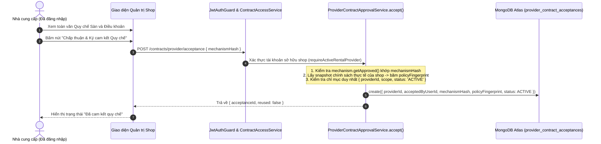

# BÁO CÁO KHẮC PHỤC SỰ CỐ P0 (P0 FIX & MITIGATION REPORT)
## CƠ CHẾ BẢO VỆ CHẤP THUẬN TỰ NGUYỆN CỦA NHÀ CUNG CẤP & CHẶN GIAO DỊCH CHẶT CHẼ (FAIL-CLOSED SAFETY GATE)

---

## 1. Các Thay đổi Mã nguồn Đã thực hiện (Applied Code Changes)

### 1.1. Tệp `backend/src/modules/contracts/contract-preparation.service.ts`
1. **Loại bỏ hoàn toàn đoạn mã tự động tạo acceptance:**
   - Xóa bỏ khối `try ... catch (err)` bắt lỗi `PROVIDER_AUTO_ACCEPTANCE_MISSING` và xóa bỏ lệnh `updateOne(..., { upsert: true })`.
   - Giờ đây, khi `this.policy.requireAutoAcceptance(...)` ném lỗi `PROVIDER_AUTO_ACCEPTANCE_MISSING`, lỗi này sẽ được ném thẳng lên trên mà không bị nuốt hoặc tự tạo dữ liệu giả mạo.
2. **Loại bỏ hoàn toàn cơ chế âm thầm cập nhật `policyFingerprint`:**
   - Thay thế đoạn code `updateOne` cập nhật fingerprint bằng lệnh ném ngoại lệ kiểm soát chặt chẽ:
     ```typescript
     if (acceptance.policyFingerprint !== hashContract(snapshot.policies)) {
       throw new UnprocessableEntityException('PROVIDER_POLICY_ACCEPTANCE_STALE');
     }
     ```
3. **Dọn dẹp mã nguồn thừa:**
   - Gỡ bỏ import không sử dụng `AUTO_ACCEPTANCE_MECHANISM_V2` và `ProviderAcceptanceStatus` trong tệp preparation service.

### 1.2. Tệp `backend/src/modules/contracts/contract-read.service.ts`
1. **Xử lý lỗi chặn tại API kiểm tra mức độ sẵn sàng (`readiness`):**
   - Khi phương thức `prepare()` ném lỗi do Provider chưa chấp thuận quy chế hoặc chính sách bị trôi (`PROVIDER_AUTO_ACCEPTANCE_MISSING`, `PROVIDER_AUTO_ACCEPTANCE_INVALID`, `PROVIDER_POLICY_ACCEPTANCE_STALE`):
   - Service bắt lỗi, đẩy mã lỗi vào danh sách `blockers` của đơn hàng.
   - Ghi nhận trạng thái của shop là `PROVIDER_ACCEPTANCE_MISSING`, thiết lập `ready: false`.
   - Ngăn không cho khách hàng tiến hành thanh toán khi Provider chưa hoàn tất nghĩa vụ pháp lý.

---

## 2. Đường chạy Hợp lệ Duy nhất (Sole Legitimate Consent Path)

Sau khi sửa lỗi P0, hệ thống chỉ chấp nhận **một đường chạy duy nhất** để một Nhà cung cấp có bản ghi chấp thuận `ACTIVE`:



- **Quyền hạn:** Bắt buộc phải là tài khoản chủ sở hữu Provider có quyền thuê áo dài (`AODAI_RENTAL`).
- **Kiểm tra phiên bản:** Nếu quy chế sàn cập nhật, hash gửi lên không khớp -> Ném `CONTRACT_MECHANISM_CHANGED` (409 Conflict).
- **Kiểm tra trùng lặp:** Áp dụng Partial Unique Index `{ providerId: 1, scope: 1 }` với `{ status: 'ACTIVE' }` để chống race conditions tạo 2 bản ghi active song song.

---

## 3. Hành vi Fail-Closed Toàn diện của Hệ thống

| Tình huống thực tế | Hành vi của Hệ thống | Mã lỗi trả về | Trạng thái Giỏ hàng / Thanh toán |
| :--- | :--- | :--- | :--- |
| Provider chưa từng bấm chấp thuận quy chế | Chặn tại `prepare()` và `readiness()` | `PROVIDER_AUTO_ACCEPTANCE_MISSING` | **BỊ CHẶN.** Không tạo hợp đồng, không cho bấm thanh toán. |
| Shop sửa đổi chính sách nhưng chưa ký lại | Chặn tại `prepare()` và `evaluate()` | `PROVIDER_POLICY_ACCEPTANCE_STALE` | **BỊ CHẶN.** Yêu cầu shop vào ký xác nhận lại chính sách mới. |
| Sàn cập nhật quy chế hoạt động | Chặn tại `ContractCheckoutGuard` | `PROVIDER_ACCEPTANCE_STALE` | **BỊ CHẶN.** Đơn hàng không thể tạo link thanh toán PayOS. |
| Người dùng khác cố tình gọi API chấp thuận thay shop | Chặn tại `ContractAccessService` | `PROVIDER_NOT_FOUND` / 404 | **BỊ TỪ CHỐI.** Không phân quyền. |
| Provider bấm "Thu hồi cam kết" (Revoke) | Trạng thái chuyển thành `REVOKED` | Chuẩn bị đơn hàng tiếp theo bị chặn | **BỊ CHẶN.** Shop ngừng nhận đơn thuê mới ngay lập tức. |
| Bảo toàn hợp đồng cũ đã ký (`ACCEPTED`) | Giữ nguyên snapshot, hash và renderedText | Chuẩn bị mới sinh Version 2 | **BẢO TOÀN.** Hợp đồng đã ký không bao giờ bị ghi đè. |

---

## 4. Thiết kế Truy vấn Kiểm toán Read-Only (MongoDB Audit Script Design)

Để kiểm tra và rà soát lại các bản ghi acceptance đã bị tạo tự động trước đây trên MongoDB Atlas mà **tuyệt đối không thực hiện bất kỳ lệnh ghi/xóa (Write/Delete) nào**, Quản trị viên sử dụng truy vấn Read-Only sau trong `mongosh` hoặc MongoDB Compass:

```javascript
/**
 * VIBEHUE — READ-ONLY ACCEPTANCE AUDIT QUERY
 * Mục đích: Phát hiện các bản ghi acceptance nghi vấn được tạo tự động bởi backend trước bản vá P0.
 * An toàn: Chỉ sử dụng $match và $project (READ-ONLY, KHÔNG DÙNG $set, $out, $merge).
 */
use('vibehue');

db.provider_contract_acceptances.aggregate([
  {
    $match: {
      status: "ACTIVE"
    }
  },
  {
    $lookup: {
      from: "providers",
      localField: "providerId",
      foreignField: "_id",
      as: "providerDoc"
    }
  },
  {
    $unwind: {
      path: "$providerDoc",
      preserveNullAndEmptyArrays: true
    }
  },
  {
    $project: {
      _id: 1,
      providerId: 1,
      businessName: "$providerDoc.businessName",
      acceptedByUserId: 1,
      providerOwnerUserId: "$providerDoc.userId",
      mechanismVersion: 1,
      mechanismHash: 1,
      policyFingerprint: 1,
      templateVersion: 1,
      acceptedAt: 1,
      // Đánh dấu nghi vấn nếu ngày chấp thuận trùng khớp với thời điểm test tự động
      isSuspiciousSynthetic: {
        $cond: {
          if: { $eq: ["$mechanismVersion", "auto-acceptance-v1"] },
          then: true,
          else: false
        }
      }
    }
  },
  {
    $sort: { acceptedAt: -1 }
  }
]);
```

> [!NOTE]
> Báo cáo kiểm toán trên được chạy độc lập dưới quyền Read-Only. Không có bất kỳ kịch bản xóa nào được thực thi trong phiên làm việc này nhằm bảo đảm an toàn dữ liệu tuyệt đối cho môi trường của Người dùng.
