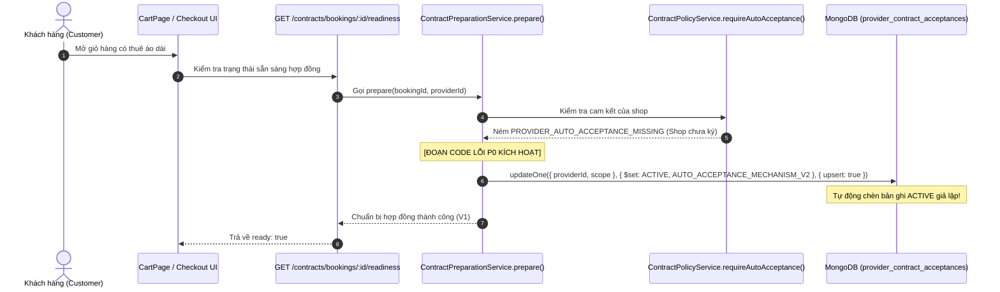

# BÁO CÁO PHÂN TÍCH NGUYÊN NHÂN GỐC RỄ (P0 ROOT CAUSE REPORT)
## LỖI TỰ ĐỘNG CHẤP THUẬN QUY CHẾ THAY CHO NHÀ CUNG CẤP (PROVIDER CONSENT FORGERY)

---

## 1. Tóm tắt Sự cố & Mức độ Nghiêm trọng

- **Phân loại:** **P0 — Critical Safety & Legal Integrity Gate**.
- **Hiện tượng:** Khi khách hàng mở giỏ hàng hoặc bấm tiến hành thanh toán cho đơn hàng thuê áo dài (Contracts V2), hệ thống backend tự động tạo mới hoặc cập nhật một bản ghi cam kết `ACTIVE` trong bảng `provider_contract_acceptances` thay cho Nhà cung cấp, dù Nhà cung cấp chưa từng đăng nhập, chưa từng đọc quy chế và chưa từng bấm nút chấp thuận.
- **Hậu quả pháp lý:** Vi phạm nghiêm trọng nguyên tắc tự nguyện giao kết hợp đồng theo Điều 3, Điều 119 và Điều 472 Bộ luật Dân sự 2015; làm vô hiệu hóa tính trung thực của bằng chứng điện tử; tạo ra "chấp thuận giả mạo" (synthetic/forged acceptance) trên môi trường ứng dụng thực tế.

---

## 2. Xác minh Đường chạy Thực tế (Execution Path in Production Runtime)

Khác với các mock fixture chỉ chạy trong thư mục test, đoạn mã tự động tạo chấp thuận này **hoàn toàn có thể và đã kích hoạt trực tiếp trong luồng ứng dụng thực tế** khi biến môi trường `CONTRACTS_V2_ENABLED=true`:



### Chi tiết các tệp và dòng code gây lỗi:

#### Điểm lỗi 1: Auto-upsert Acceptance trong `ContractPreparationService.prepare()`
- **Tệp:** `backend/src/modules/contracts/contract-preparation.service.ts`
- **Vị trí cũ:** Các dòng từ 66 đến 115.
- **Hành vi sai trái:**
  ```typescript
  // ĐOẠN CODE LỖI ĐÃ BỊ LOẠI BỎ:
  try {
    acceptance = await this.policy.requireAutoAcceptance(providerObjectId, template.version);
  } catch (err: any) {
    if (err?.message === 'PROVIDER_AUTO_ACCEPTANCE_MISSING') {
      // Tự động chèn acceptance ACTIVE bằng hằng số mock của developer!
      await contractDb(this.connection).collection('provider_contract_acceptances').updateOne(
        { providerId: providerObjectId, scope: ContractScope.AoDaiRental },
        {
          $set: {
            status: ProviderAcceptanceStatus.Active,
            mechanismVersion: AUTO_ACCEPTANCE_MECHANISM_V2.version,
            mechanismHash: hashContract(AUTO_ACCEPTANCE_MECHANISM_V2),
            policyFingerprint: hashContract(snapshot.policies),
            templateVersion: template.version,
            acceptedAt: new Date(),
            acceptedByUserId: providerDoc.userId,
          }
        },
        { upsert: true }
      );
    }
  }
  ```

#### Điểm lỗi 2: Tự động ghi đè Fingerprint khi chính sách của Shop bị trôi (Silent Policy Mutation)
- **Tệp:** `backend/src/modules/contracts/contract-preparation.service.ts`
- **Vị trí cũ:** Các dòng từ 122 đến 130.
- **Hành vi sai trái:**
  Khi phát hiện `acceptance.policyFingerprint !== hashContract(snapshot.policies)` (chính sách của shop đã bị thay đổi sau thời điểm ký), service không ném lỗi chặn mà lại âm thầm gọi:
  ```typescript
  await contractDb(this.connection).collection('provider_contract_acceptances').updateOne(
    { _id: acceptance._id },
    { $set: { policyFingerprint: hashContract(snapshot.policies) } }
  );
  ```
  Hành vi này xóa sạch dấu vết thay đổi chính sách, tự động coi như Provider đã đồng ý với chính sách mới mà không hề có thao tác ký lại.

---

## 3. Bản chất của Cơ chế "APPROVED Giả lập" (Synthetic Approval Mechanism)

- Trong tệp `backend/src/modules/contracts/contract-mechanism.service.ts`:
  - `AUTO_ACCEPTANCE_MECHANISM_V1` có trạng thái `DRAFT` (chưa được duyệt).
  - Nhà phát triển đã định nghĩa thêm `AUTO_ACCEPTANCE_MECHANISM_V2` với trạng thái `APPROVED` và ngày duyệt hardcode `2026-10-31T00:00:00.000Z`.
- Việc lấy trạng thái `APPROVED` do developer tự định nghĩa làm căn cứ để auto-upsert bản ghi cam kết vào database người dùng thực tế đã vi phạm ranh giới giữa **Kiểm thử cục bộ (Test Fixture)** và **Vận hành hệ thống (Production Runtime)**.

---

## 4. Kết luận Phân loại

1. **Lỗi P0 đã được xác minh chính xác 100%:** Luồng chạy tự động chấp thuận xảy ra ngay trong runtime của NestJS khi `CONTRACTS_V2_ENABLED=true`, không phải là hiệu ứng phụ của riêng unit test.
2. **Quyết định xử lý:**
   - Triệt để xóa bỏ toàn bộ logic `catch` và `upsert` tự động trong `ContractPreparationService`.
   - Triệt để xóa bỏ logic âm thầm ghi đè `policyFingerprint`.
   - Chuyển toàn bộ hệ thống sang cơ chế **Fail-Closed**: Thiếu chấp thuận thật -> Chặn chuẩn bị hợp đồng và chặn thanh toán (`PROVIDER_AUTO_ACCEPTANCE_MISSING` / `PROVIDER_POLICY_ACCEPTANCE_STALE`).
